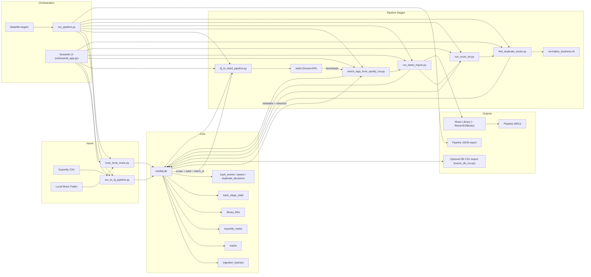
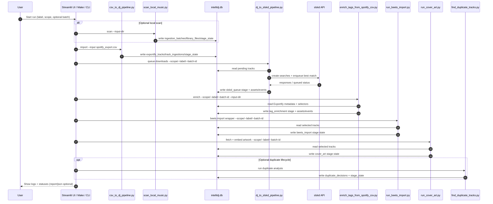

# Architecture (DB-first)

## Key ideas

- `intellidj.db` is the single source of truth between stages.
- CSV is only for ingestion (and optional DB export), not for stage-to-stage handoff.
- Stage execution is selectable with `--scope`, `--label`, and `--batch-id`.
- Every stage writes lifecycle state back into DB for traceability.

## Sequence Diagram (Typical Run)

